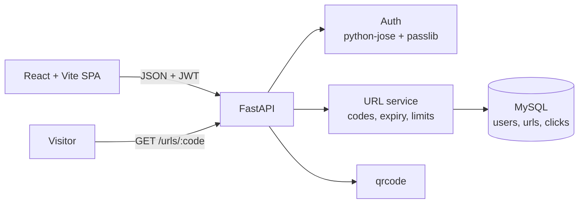

# 🔗 LinkSnap — URL Shortener


A full-stack URL shortener with user accounts, custom short codes, link expiry and click limits, per-link click analytics, and QR codes. The backend is **FastAPI** with **MySQL**; the frontend is **React + Vite** with a custom CSS design system.

## ✨ Features

- **Short links**: turn a long URL into a short code, or choose your own custom code
- **Accounts**: register and log in with JWT authentication; each user sees and manages their own links
- **Expiry and click limits**: a link stops working after its expiry date (410 Gone) or once it reaches its click limit
- **Click analytics**: every redirect is recorded; the analytics endpoint returns totals, a per-day chart series and recent clicks
- **QR codes**: download a QR code for any short link
- **Copy to clipboard** and a responsive dark UI

## 🏗️ Architecture



More detail, including the request flow, is in [docs/ARCHITECTURE.md](docs/ARCHITECTURE.md).

## 🛠️ Tech Stack

| Layer | Technology |
|-------|------------|
| Backend | FastAPI, Uvicorn |
| Database | MySQL, SQLAlchemy Core, `databases` (async) with aiomysql |
| Auth | JWT (python-jose), bcrypt (passlib) |
| QR codes | qrcode, Pillow |
| Frontend | React, Vite, plain CSS design system |
| Deployment | Docker; Vercel (frontend), Render (backend), TiDB Cloud (MySQL) |

## 🚀 Getting Started

### Prerequisites

- Python 3.10+
- Node.js 20.19+ or 22.12+
- MySQL 8 (or any MySQL-compatible database)

### 1. Clone

```bash
git clone https://github.com/pruthvi300/linksnap.git
cd linksnap
```

### 2. Backend

```bash
cd backend
python -m venv venv
source venv/bin/activate          # Windows: venv\Scripts\activate
pip install -r requirements.txt

cp .env.example .env              # then set your MySQL credentials and SECRET_KEY
mysql -u root -p -e "CREATE DATABASE url_shortener;"

uvicorn app.main:app --reload --port 8000
```

The tables are created automatically on first start. API docs: http://localhost:8000/docs

### 3. Frontend

In a second terminal:

```bash
cd frontend
npm install
npm run dev
```

Open http://localhost:5173. The frontend calls `http://localhost:8000` by default; set `VITE_API_URL` to point it at another backend.

> Once both are installed, `./start.sh` from the repo root starts the backend and frontend together (uses gnome-terminal or tmux).

## 🔧 Configuration

Backend settings come from `backend/.env` (see [backend/.env.example](backend/.env.example)):

| Variable | Description |
|----------|-------------|
| `MYSQL_USER`, `MYSQL_PASSWORD`, `MYSQL_HOST`, `MYSQL_PORT`, `MYSQL_DB` | MySQL connection |
| `SECRET_KEY` | Key used to sign JWTs. Use a long random value. |

Frontend: `VITE_API_URL` (defaults to `http://localhost:8000`).

## 📡 API Endpoints

| Method | Endpoint | Description |
|--------|----------|-------------|
| `POST` | `/auth/register` | Create an account |
| `POST` | `/auth/login` | Log in, returns a JWT |
| `GET` | `/auth/me` | Current user |
| `POST` | `/urls/create` | Create a short link |
| `GET` | `/urls/me` | List your links |
| `DELETE` | `/urls/{url_id}` | Delete one of your links |
| `GET` | `/urls/{short_code}` | Redirect to the original URL (records a click) |
| `GET` | `/urls/{short_code}/qr` | QR code image for a link |
| `GET` | `/analytics/{short_code}` | Click totals, per-day chart data and recent clicks |

Example request body for `POST /urls/create`:

```json
{
  "original_url": "https://example.com/a/very/long/path",
  "custom_code": "my-link",
  "expires_at": null,
  "click_limit": null
}
```

## 📝 Data Model

| Table | Key columns |
|-------|-------------|
| `users` | `id`, `name`, `email` (unique), `password_hash`, `role`, `created_at` |
| `urls` | `id`, `user_id`, `original_url`, `short_code` (unique), `title`, `expires_at`, `click_limit`, `created_at`, `updated_at` |
| `clicks` | `id`, `url_id`, `clicked_at`, `ip_address`, `user_agent`, `referer`, `country_code` |

## 📁 Project Structure

```text
linksnap/
├── backend/
│   ├── app/
│   │   ├── api/          # auth, urls, analytics routes
│   │   ├── core/         # settings
│   │   ├── models/       # users, urls, clicks tables
│   │   ├── schemas/      # Pydantic models
│   │   ├── services/     # short-code generation and link rules
│   │   ├── utils/        # password hashing and JWT helpers
│   │   ├── db.py         # database connection
│   │   └── main.py       # FastAPI app
│   ├── requirements.txt
│   └── Dockerfile
├── frontend/
│   ├── src/
│   │   ├── components/   # Header, AuthPage, URLShortenerForm, URLList
│   │   ├── App.jsx
│   │   └── index.css     # design tokens and components
│   ├── vercel.json
│   └── Dockerfile
├── docs/
│   ├── ARCHITECTURE.md
│   └── DEPLOYMENT.md
└── start.sh
```

## ☁️ Deployment

The app can run entirely on free tiers: frontend on Vercel, backend on Render (Docker), database on TiDB Cloud Serverless. Step-by-step instructions are in [docs/DEPLOYMENT.md](docs/DEPLOYMENT.md).

## 🚧 Roadmap

- Custom domains
- Password-protected links
- Bulk shortening and CSV export of analytics
- Automated tests and CI

## 📄 License

[MIT](LICENSE)
